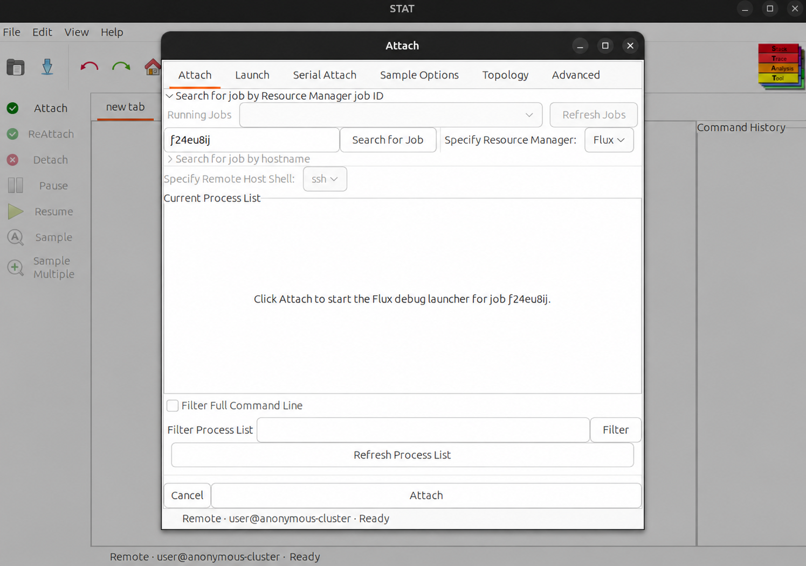

# Using STAT remotely over SSH

The desktop GUI and command-line client start a STAT server on the cluster over SSH. Install STAT on cluster
and then locally on laptop/desktop to attach to your application, collects stack samples, and detaches.

## Install on the cluster and on your desktop

- **Cluster** — [Build and install STAT](../INSTALL) on the host that will run `stat-gui-server`. Keep the default
  GUI-enabled build, which installs the server and its Python bindings. The server runs without a display.
  Make the installation available on the compute nodes where STAT launches its daemons (shared filesustem).
  Dyninst is the default sampling backend. Use `--backend gdb` for CPU GDB sampling on a GDB-enabled server.
  For faster CUDA device traces, configure the server to use `cuda-gdb` (`STAT_GDB`) and add `--with-threads --cuda-quick`.
  In the remote GUI, select GDB and use **Attach → Advanced → GDB Path** to override the server default for this attach.

- **Desktop GUI** — Install the standalone `stat-gui` package and its graphics dependencies using the
  [desktop GUI installation guide](../scripts/gui/README.md). The desktop GUI can run without native STAT libraries.

- **Desktop CLI** — The same standalone package installs `stat-gui-remote-cli`. The command runs with Python and OpenSSH
  and can connect without native STAT libraries or a graphical display on the desktop.

From the client machine, verify noninteractive SSH access with `ssh -o BatchMode=yes user@login-host true`.
The clients use your OpenSSH configuration. To pass extra options, use `--ssh-option`, for example
`--ssh-option=-p --ssh-option=2222`. In the examples, `--remote-prefix` points to the STAT installation on
the host that runs the server.

## Standalone desktop GUI

Once STAT GUI is installed, you can start STAT GUI and connect to cluster as:

```bash
stat-gui --remote-login user@login-host --remote-prefix /path/to/stat/install/prefix/dir
```

This command connects to the cluster head node (`login-host`) over SSH and starts the STAT server from the
STAT installation directory specified by `--remote-prefix` on the cluster.

If you open the standalone GUI without an SSH login, **Attach** prompts you to restart it with the command above.

With `--remote-login`, STAT opens the classic tabbed **Attach** dialog and lists running Slurm jobs under
**Search for job by Resource Manager job ID**. The first batch job is selected when available.
Choose a job in **Running Jobs** or enter its ID and click **Search for Job**. The **Current Process List**
shows launcher PIDs and command lines on the resolved host. Select the launcher, choose the backend on
**Sample Options**, and click **Attach** on the first tab to collect the first graph.

The main window and Attach dialog show the SSH login and the current operation while a request is running.
The status returns to **Ready** when the request finishes, or **Disconnected** if the SSH connection closes.


Use **Refresh Jobs** to find newly started jobs and **Refresh Process List** to look up the selected job again.

If you start the standalone GUI without a login, click **Attach** to enter the SSH login and optional remote STAT prefix.
Browsing requires a working STAT installation on the login host or the host supplied with `--remote-server-host`.

You can also start with a known target:

```bash
stat-gui --remote-login user@launcher-host --remote-prefix /path/to/stat-install -i -a JOB_LAUNCHER_PID
stat-gui --remote-login user@server --remote-prefix /path/to/stat-install --backend pystack --native --with-children -i -I SERIAL_PROC_PID
```

To attach to a job in a Flux allocation, pass the allocation ID and the application job ID:

```bash
stat-gui --remote-login user@login-host --remote-prefix /path/to/stat-install \
  --flux-allocation ALLOCATION_ID --remote-job APPLICATION_JOB_ID --scheduler flux
```

The **Attach** dialog opens with the Flux job ID filled in. The process list stays empty because STAT starts a Flux
attach helper on demand. Click **Attach** to start the helper and collect the first sample.



## Using the Remote Connect CLI

STAT remote client installation also provides CLI interface that can be used if needed for specific use cases.

### Check your connection

Run the status command from the client machine. Replace the login and installation prefix with your cluster settings.

```bash
stat-gui-remote-cli --remote-prefix /path/to/stat/install/dir --remote-login user@cluster status
```

The output should look like:

```json
{
  "git_commit": "1a9df8d2ae86dcb119c3175b9a37cfb0bfcf9fab",
  "git_dirty": true,
  "hostname": "cluster-0629",
  "stat_version": "4.3.0",
  "supported_backends": [
    "dyninst",
    "pystack"
  ],
  "user": "user"
}
```

The command reports the server's hostname, user, supported backends and build version. `git_commit` records the source revision
and `git_dirty` indicates tracked changes at configure time. Git fields are `"unknown"` when source metadata is unavailable.

Commands print JSON results on standard output and diagnostics on standard error. An error response contains `ok: false` and
an `error` object; the command exits with a nonzero status.

### Sampling options and output

For Python stacks, add `--backend pystack` to `sample-process` or `sample-job`. Add `--native` for C/C++ frames
or `--with-children` for descendant processes.

After a successful sample, stdout reports the local output directory, server hostname and remote output directory as JSON.
Open the local path in `response_file` for the full response, including DOT text. The client saves this file and the DOT graphs
under `./stat_results/run-*` by default. Use `--output-dir ./my-samples` to choose a directory. Files with the same names
in an explicitly chosen directory are overwritten.

For example, sampling an MPI ring job with the default options prints:

```json
{
  "output_dir": "/home/user/stat_results/run-20261124-141708-byuqqlhv",
  "remote_host": "compute-01",
  "remote_output_dir": "/home/user/stat_results/mpi_ringtopo.0035",
  "response_file": "/home/user/stat_results/run-20261124-141708-byuqqlhv/response.json"
}
```

Add `-v` or `--verbose` to `sample-job` or `sample-process` to print session details and the remote (`dot_filename`)
and local (`local_dot`) graph paths. Use `-vv` for the full JSON previously printed by default, including the DOT text.
This output matches the saved `response.json`.

Sampling collects one snapshot by default and detaches before returning. With multiple snapshots, the `merged` entry
identifies the accumulated 3D graph. Open a downloaded graph with `stat-view /path/to/graph.dot`, or start `stat-gui`
and choose **File > Open**. The examples below show excerpts from the saved `response.json`.

Use `--with-threads` to include threads, or `--sample-type 'function only'` for function-only traces. By default, the
application stays paused between snapshots. To let it run between snapshots, add `--trace-frequency MS` to a command
with `--samples 2` or more. For example, `--samples 2 --trace-frequency 2500` collects two snapshots with 2.5 seconds of
application run time between them. Use `--trace-frequency 0` to keep it paused. You can also use
`--resume-between-samples` as a shortcut for 1000 ms when you omit `--trace-frequency`.

Sampling defaults match the classic GUI: up to five retries of a failed or incomplete stack walk, with a 10-microsecond
interval. You normally do not need to set these options. Use `--num-retries` and `--retry-freq` to adjust them when
troubleshooting incomplete native traces; these do not retry SSH connections. Dyninst may briefly resume a stopped process
between stack-walk retries. `--num-retries 0` disables retries.

Graph edges retain the full list of contributing ranks, matching the classic GUI default.

### Sample a serial process

On the cluster, compile and start the example from the STAT source directory:

```bash
cc -g -O0 examples/src/serial.c -o serial
./serial > serial.log 2>&1 &
echo "$!"
```

The example sleeps for about 30 seconds, so run the client command promptly while it is alive. Replace `12345` with its
printed PID:

```bash
stat-gui-remote-cli --remote-login user@server \
  --remote-prefix /path/to/stat-install \
  sample-process 12345 --serial --samples 2 --output-dir ./serial-samples
```

`--serial` attaches directly to that process on the server. A separate single-sample run captured `myfun` and `mysleep` in one 2D snapshot.

```json
{
  "attach": {"mode": "serial", "state": "attached"},
  "detach": {"state": "detached"}
}
```

Open the DOT files in `./serial-samples` on your client. The command above writes two snapshots and a merged graph.

### Sample an MPI application

On the cluster, start your MPI application and record its launcher PID:

```bash
mpirun -n 4 ./my-mpi-application > application.log 2>&1 &
echo "$!"
```

While it is running, use the printed PID from your client machine:

```bash
stat-gui-remote-cli --remote-login user@launcher-host \
  --remote-prefix /path/to/stat-install \
  sample-process 12345 --samples 2 --output-dir ./mpi-samples
```

Here `12345` is the `mpirun` PID, not a rank PID or shell wrapper's PID. Omit `--serial` so STAT samples the ranks registered
with the launcher. The server runs on the launcher's host even when ranks run on other nodes. For an existing application,
identify its launcher rather than starting another `mpirun`.

Both snapshots from this run contained all four MPI ranks.

```json
{
  "attach": {"pid": 3794321, "state": "attached"},
  "detach": {"state": "detached"}
}
```

Look in `./mpi-samples` on your client. This run saved `00_attach-demo.00XX.2D.dot`, `01_attach-demo.00XX.2D.dot`,
and the merged graph `02_attach-demo.00XX.3D.dot`.

### Sample a Slurm job

For a running Slurm job, provide its job ID from a server with access to Slurm:

```bash
stat-gui-remote-cli --remote-login user@login-host \
  --remote-prefix /path/to/stat-install \
  sample-job JOBID --scheduler slurm --samples 2 --output-dir ./job-samples
```

Replace `JOBID` with your job ID. STAT resolves the launcher through its resource-manager helper; you do not need to supply
rank PIDs or call discovery commands first.

`sample-job JOBID --scheduler slurm` selects Slurm explicitly. The default `--scheduler auto` detects available launcher
commands on the server and requires explicit selection when detection is missing or ambiguous. Job IDs remain strings.
Schedulers like `lsf` and `alps` reuse STAT's existing helpers and have not been cluster-tested here.
Job listing currently supports Slurm.

This run sampled four ranks across two Slurm nodes.

```json
{
  "attach": {
    "rm": "slurm",
    "job": {"jobid": "81", "launcher_exe": "srun"},
    "state": "attached"
  },
  "detach": {"state": "detached"}
}
```

Look in `./job-samples` on your client. This run saved `00_rank_test.0011.2D.dot`, `01_rank_test.0011.2D.dot`,
and the merged graph `02_rank_test.0011.3D.dot`.

### Sample a Flux job

On the login host, run `flux jobs -R` to see the outer allocation and the application running inside it.

```text
$ flux jobs -R
       JOBID USER      NAME       ST NTASKS NNODES     TIME INFO
  ƒESxaZPeGP user      stat-demo+  R      2      2   6.231s compute-[01,02]

ƒESxaZPeGP:
    ƒ25GUqV1 user      stat-demo+  R      4      2   4.093s compute-[01,02]
```

Take the allocation ID from the outer row (`ƒESxaZPeGP`) and the application job ID from the indented row
(`ƒ25GUqV1`). To confirm the application ID, list the running jobs inside the allocation.

```text
$ flux proxy ƒESxaZPeGP flux jobs -f running
       JOBID USER      NAME       ST NTASKS NNODES     TIME INFO
    ƒ25GUqV1 user      stat-demo+  R      4      2   6.059s compute-[01,02]
```

From your client, pass the outer ID to `--flux-allocation` and the inner ID to `sample-job`. Replace both IDs with those from your running job.

```bash
stat-gui-remote-cli --remote-login user@login-host --remote-prefix /path/to/stat-install --flux-allocation ƒESxaZPeGP \
  sample-job ƒ25GUqV1 --scheduler flux --samples 2
```

The server loads its installed environment before running `flux proxy ALLOCATION_ID`. It can use the Flux path found
when STAT was configured, or the one already on the SSH session's `PATH`. The noninteractive SSH session must also
be able to reach the Flux broker through a local socket or a site-configured `FLUX_URI`. A profile loaded only in a login
shell may leave `FLUX_URI` unset for Remote Connect. Check with `ssh -T user@login-host 'flux jobs'` if Flux is on your SSH `PATH`.
Select `--scheduler flux` explicitly on clusters that also provide Slurm.

The server starts `flux job attach --read-only --debug` for the selected application, attaches STAT to the helper PID,
and releases the helper after detach. This requires a running job and a Flux-capable LaunchMON installation with permission
to launch STAT daemons in that instance. If you already started a debug helper, use `sample-process PID` on its host in
the same Flux instance.

A separate STAT sampling run captured four ranks across two Flux nodes.

```json
{
  "attach": {
    "rm": "flux",
    "job": {"jobid": "ƒ21EEnxX", "launcher_exe": "flux-job"},
    "state": "attached"
  },
  "detach": {"state": "detached"}
}
```

## Connect through a login node to a compute node

Use `--remote-server-host` when you need to reach a compute node through a login node. This is useful when the login node
serves as a jump host or when the login and compute nodes have different architectures. For example, if the login node is
x86_64 and the compute nodes are AArch64, build STAT for the compute nodes. The resulting STAT binaries and libraries
cannot run on the x86_64 login node.

Choose an AArch64 compute node in your job allocation where STAT can reach the job launcher. Use the first compute node if your
launcher runs there. From the login node, verify that you can SSH to the selected compute node without a prompt. Then run
the command below from your laptop or desktop, replacing the hosts, installation path, and job ID with your own values.

```bash
stat-gui-remote-cli --remote-login user@login-host \
  --remote-server-host compute-arm-01 \
  --remote-prefix /path/to/arm-stat-install \
  sample-job JOBID --scheduler slurm --samples 2
```

The client connects to `user@login-host` first. From there it uses SSH to start `stat-gui-server` on `compute-arm-01`.
Specify the installation path as it appears on that compute node.

The CLI uses the login host unless you specify `--remote-server-host`. The desktop GUI can choose a host for a
Slurm attachment. It tries the launcher host first, then tries the first allocated node if the launcher is
outside the allocation and server startup there fails. To browse jobs when STAT cannot run on the login host,
supply `--remote-server-host` with a compatible host that can query Slurm.

## Sessions and connection loss

Normal sampling commands detach before returning. The server attempts to detach when the client closes its connection. An SSH
disconnect or command timeout does not guarantee cleanup: an operation may still be running, and the application may remain paused.
Check that the application is running before starting another attachment. Future releases will add extra API for retrying cleanup.
